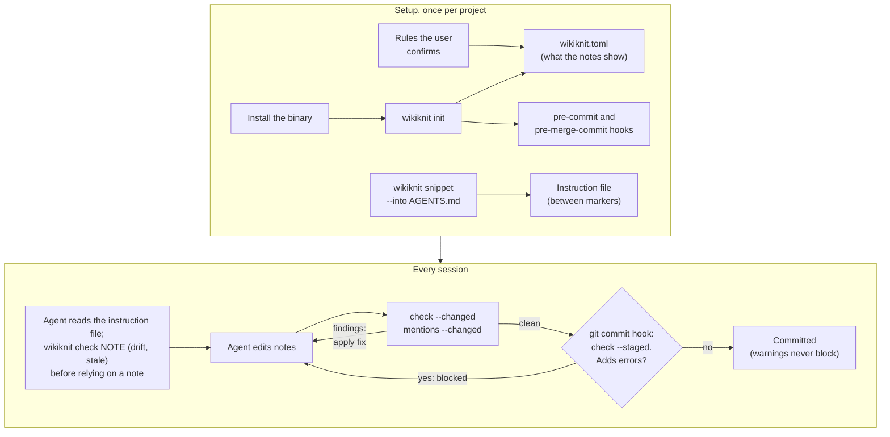

# wikiknit

A linter for Markdown vaults (Obsidian, and anything else that uses `[[wikilinks]]`) that AI agents
keep as their memory. It finds what makes a vault mislead the agent that reads it: broken links,
links the vault's own rules require, notes that name another note without linking it, notes that
fell behind the repository they describe, and resolved issues still listed as open.

**Set it up:** ask your agent: "Set up wikiknit for this vault, following
https://github.com/victorkwak/wikiknit/blob/main/docs/agent-install.md"

- **check**: broken links, wrong link style, unquoted links in frontmatter, links hidden in code or
  HTML, notes with no outgoing link, orphans, links your rules require (in either direction), links
  your rules forbid, stale notes, notes that drifted from their repository, aliases two notes share.
  Each finding has a fix.
- **check --staged**: only what the next commit adds. Run it from a git pre-commit hook.
- **mentions**: text that names another note (by its name or an alias) without linking it.
- **links**: the notes linked to or from a note, with the line each link is written on.
- **catalog**: one line per note (id, type, tags, aliases, title, summary), to pick link targets.
- **graph**: connected components with index ("hub") notes left out, so isolated clusters show up.
- **init**: set a vault up: a starter `wikiknit.toml` and the git hooks.
- **snippet**: the instructions for agents, for the project's `AGENTS.md` or `CLAUDE.md`.

wikiknit reads the files directly (Obsidian does not need to run) and never edits notes: the agent
does, with the fix wikiknit gives. It is fast: `check` on a 5,000-note vault takes about 0.2 s.

## How it fits together



Setup is what [docs/agent-install.md](docs/agent-install.md) walks an agent through. `init`
writes only what the notes show and never overwrites a config or a hook it did not write; hooks in
`.git/hooks` are per clone (run `init` again there). Details: [Install](#install).

## Why it is small

wikiknit does not search the vault, build context packs, suggest links, or hold an agent's work
until it confirms a link pass. Each was tested with agents and did not earn its place:

- An agent's own search and read tools answer recall questions as well as a ranked context pack,
  with fewer tokens and no risk of cutting off the part that holds the answer.
- Agents skip link suggestions, and they clear a "confirm your link pass" gate without changing a
  link. Such a gate enforces a step, not link quality.
- What misleads agents is stale notes that contradict themselves. `drift` and `forbid_link` catch
  the kinds of staleness that can be found without guessing.

What wikiknit does is deterministic: each check finds a real defect or stays quiet. The git hook blocks only
when a commit adds an error, and it runs for every `git commit`, whoever runs it.

## Install

Prebuilt binaries for Linux (x86_64, aarch64; static) and macOS (arm64, x86_64), with a SHA-256
check, into `~/.local/bin`:

```bash
curl -fsSL https://raw.githubusercontent.com/victorkwak/wikiknit/main/install.sh | sh
```

`WIKIKNIT_VERSION=v0.8.1` pins a release; `WIKIKNIT_INSTALL_DIR` picks the folder. Windows: the
`.zip` on the [releases page](https://github.com/victorkwak/wikiknit/releases). With Rust:

```bash
cargo binstall wikiknit                                               # the release binary, via cargo-binstall
cargo install --locked wikiknit                                       # build from crates.io
cargo install --locked --git https://github.com/victorkwak/wikiknit   # build the latest main
```

Then, from the project that holds the vault:

```bash
wikiknit init --dry-run          # what it would do
wikiknit init                    # wikiknit.toml + git hooks; a second run changes nothing
wikiknit snippet --into AGENTS.md    # or CLAUDE.md: the instructions for agents
```

`init` finds the vault (the folder with `.obsidian/`; without one it names the folder that holds
the notes with `[[wikilinks]]` and stops: pass `--vault <folder>`) and its git repository. It
keeps a `wikiknit.toml` that already names the vault (in the vault folder or above it). Else it
writes one at the repository top with only what the notes show: `link_style` (`full-path`
when at least 95% of the links to notes in folders give the full path, `shortest` when most give a
shorter name, nothing when they are mixed; with fewer than 5 such links and none shorter, `full-path`
when Obsidian's `newLinkFormat` is `absolute`), `hubs` (notes that link at least a quarter of the
others, at least 5, and at least 3 times as many as the median note),
and `ignore` for the templates folder (the one Obsidian's Templates or Templater plugin names,
else a top-level `Templates/` or `_templates/`, any case). Each value comes with the reason in a comment. It writes no rules:
add those yourself (see [Configure](#configure)).

Then it installs `pre-commit` and `pre-merge-commit` hooks that run `wikiknit check --staged`
(with `--config <path>` when the config is not at the repository top), in the folder git runs
hooks from: `core.hooksPath` when the repository sets it, else `.git/hooks`. It does not
overwrite:

- An existing `wikiknit.toml` is kept as it is (`--config <file>` names one, or where a new one
  goes).
- A hook wikiknit did not write is left alone: `init` prints the line to add to it and exits 1
  (for the pre-commit framework, husky, or lefthook, it names their config instead). The line runs
  only where the config exists, so it is safe in a hooks folder other repositories share. A hook
  that already runs this config's `wikiknit check --staged` is accepted.
- A hook wikiknit wrote gets one line per config (a second vault in the repository adds a line).
- `core.hooksPath` set in your global git config, or naming a folder outside the repository, is
  shared with other repositories: `init` does not write there (exit 1, with the line to add).
- Outside a git repository it writes the config in the vault folder and skips the hooks.
- The config is written beside its place, loaded, then moved in: a config that does not load is
  never left behind.

`.git/hooks` is not committed: in a new clone, run `wikiknit init` again.

`snippet` prints the agent instructions of this version between `<!-- wikiknit:start -->` and
`<!-- wikiknit:end -->`; `--into <file>` puts them in that file: it replaces the block when the file
has one, else adds it at the end. Run it again after an upgrade.

## Use

```bash
wikiknit check                         # every note; exit 1 on errors; each with a fix
wikiknit check --changed               # only what the uncommitted changes add (vs HEAD)
wikiknit check --staged                # only what the next commit adds (the index vs HEAD)
wikiknit check Projects/x INDEX        # these notes
wikiknit mentions --changed
wikiknit links gatehouse --depth 2 --in    # notes linking to it, two hops
wikiknit catalog --path Projects/ --where status=active
wikiknit graph
```

`--changed` and `--staged` compare the vault with the last commit and report only the findings the
change adds: a broken link a note already had is not the change's problem, even when the change
moves it to another line, renames its note, or rewords it (findings compare by note, rule, and what
they are about). Renames are the ones git finds (a note renamed and mostly rewritten in one commit
counts as a new note), plus notes moved with plain `mv`. The broken links a deleted or renamed note
leaves in other notes are the change's problem, and are reported. Before the first commit, every finding is new. Each version is read with
its own `wikiknit.toml` when the repository has one: a commit that adds a rule is checked by it.

- `--staged` reads what the commit will record (the index; `git add -N` files are not in it).
- `--changed` reads the work tree: tracked files, and new files git does not ignore.

Both need the vault to be in a git work tree.

Filters (`links`, `catalog`): `--type`, `--path <prefix>`, `--where key=regex` (frontmatter;
case-insensitive and matching anywhere in the value, so anchor with `^...$` for an exact value; lists
match any element), `--tag` (frontmatter `tags` and inline `#tags`; a tag also matches its nested
tags), `--linked-to <note>`. Repeat a flag to accept any of its values. A note can be named by its id,
path, link target, name, alias, or folder (`Projects/x` for `Projects/x/overview`).

`links` rows give `dir` (`out`, `in`, `both`), `depth`, the note, `via` (the note one hop closer to the
start), `source`/`line`/`context` (where the link is written, and the text around it), and for `both`
also `back_line`/`back_context` (the link back).

### Output

Output is for agents. Each command prints a `# field...` header line, then one tab-separated record
per line, and nothing at all when there are no records (a clean `check` prints nothing). Lists inside a
field are `;`-separated. `--format json` prints one compact object instead:

```json
{"schema_version":1,"command":"check","items":[{"note":"INDEX","line":12,"severity":"error","rule":"unresolved-link","message":"[[Projects/gatehous]] points to no note or file","fix":"did you mean [[Projects/gatehouse/overview]]"}]}
```

`schema_version` changes only when a record's fields change incompatibly.

wikiknit looks for `wikiknit.toml` in the current directory and its parents, up to the top of the git
work tree it is in (a config above the repository belongs to something else; from inside a nested
repository or submodule in a vault, pass `--config`). `--vault <dir>` uses
the `wikiknit.toml` in or above that folder that names it as its vault, else defaults; a broken
`wikiknit.toml` in the vault folder itself is an error, not a silent fallback to defaults.

## Git pre-commit hook

`wikiknit init` installs this as `pre-commit` and `pre-merge-commit`. To write it yourself:

```sh
#!/bin/sh
# .git/hooks/pre-commit (chmod +x), or a tracked .githooks/pre-commit with
# `git config core.hooksPath .githooks`. Copy it to pre-merge-commit too.
command -v wikiknit >/dev/null 2>&1 || { echo "wikiknit is not on PATH; vault not checked" >&2; exit 0; }
wikiknit check --staged || exit $?
```

Git runs hooks at the top of the work tree. When `wikiknit.toml` is not there (it is in the vault
folder, say), name it: `wikiknit --config notes/wikiknit.toml check --staged`. (`cd notes` first also
works, except in a repository whose work tree git is given separately, such as a bare dotfiles
repository: after a `cd` the hook can no longer tell where that work tree starts.)

The hook checks exactly what the commit records: during `git commit -a` or `git commit <paths>` git
gives the hook a temporary index, and wikiknit reads that one; in a linked worktree it reads that
worktree's. A commit in another repository (a superproject whose config names a vault inside a
submodule) records nothing of the vault and is not checked. It blocks only when the commit adds an
error; warnings (orphans, stale notes, drift) are
printed and do not block. `git commit --no-verify` skips it.

What it does not see:

- A merge that commits by itself runs `pre-merge-commit`, not `pre-commit`: install the same script
  under that name too. `cherry-pick`, `rebase`, and `revert` run neither hook.
- `git commit --amend` compares with the commit being amended (git does not tell a hook it is an
  amend), so an error that commit already had counts as old.

`--staged` writes the index as a tree into a temporary object store; wikiknit only reads the
repository.

Hooks are per clone: git does not copy them, so a fresh clone runs no check until `wikiknit init`
runs there (it keeps the config and adds the hooks).

### In CI

The hook runs on each machine that has it. A CI step catches what reaches the repository any
other way (a clone without the hook, `--no-verify`, a rebase or cherry-pick): it fails when the
vault has any link error. For GitHub Actions:

```yaml
  vault-links:
    runs-on: ubuntu-latest
    steps:
      - uses: actions/checkout@v7
      - run: curl -fsSL https://raw.githubusercontent.com/victorkwak/wikiknit/main/install.sh | sh
      - run: ~/.local/bin/wikiknit check          # add --config <path> if wikiknit.toml is not at the top
```

Pin `WIKIKNIT_VERSION` in the step's `env` to upgrade on purpose. A vault that has errors already
fails from the start: fix them first, or check only what each push adds by comparing with the
previous commit in your own script.

## Configure

```toml
# wikiknit.toml
vault = "notes"                 # vault folder: a relative path inside this file's folder (default ".");
                                # it may be a symlink, but not to /, your home, or a folder above this one
link_style = "full-path"        # or "shortest" (Obsidian's default; resolution is best-effort)
ignore = ["Templates/"]         # folders not checked (links to notes there still resolve)
hubs = ["INDEX"]                # index notes: not mention targets, left out of graph components
                                # (note ids; `./INDEX.md` works too)
alias_only = ["Systems/"]       # notes named with common words: found in prose by aliases only
min_alias_len = 4               # shorter names and aliases are not matched as mentions
generic_names = ["overview", "index", "readme"]  # stems that take their folder's name
orphan_exempt = ["Sessions/"]   # notes that need no inbound link (the `orphan` rule skips them)

# A note whose frontmatter `scope` is "project/<name>" must link Projects/<name>/overview.
[[require_link]]
when = { field = "scope", matches = "^project/(.+)$" }
target = "Projects/$1/overview"

# Research notes must link their report.
[[require_link]]
when = { path = "^Research/notes/([^/]+)/" }
target = "Research/reports/$1"

# The notes a rule matches must be linked from another note ($1... are capture groups).
[[require_inbound]]
when = { path = "^Issues/open/" }
from = "INDEX"

# Links that must not be written: here, a resolved issue on a line or under a heading that says
# "open". `from` (optional) limits the rule to the notes that link.
[[forbid_link]]
target = "^Issues/resolved/"
from = "^(INDEX|Projects/)"
near = "(?i)\\bopen\\b"
message = "a resolved issue is listed as open"

# Freshness: the first rule whose `path` matches a note applies; no `path` matches every note.
[[stale]]
field = "last_verified"         # frontmatter date, YYYY-MM-DD (a time after it is fine)
days = 30
path = "^Systems/"
fix = "run scripts/snapshot.sh"  # optional: the fix to show instead of the default

# Drift: a note that names a repository (`path: ~/Repos/x`) and the commit it was checked against
# (`verified_commit: 1a2b3c4`) gets the number of commits made there since.
[[drift]]
path = "^Projects/[^/]+/overview$"
repo_field = "path"             # default
commit_field = "verified_commit"  # default

[severity]                      # per rule: "error", "warn", or "off"
link-in-code = "warn"
```

Keys of removed features (`stemmer`, `embedding_model`, `link_section`, `min_similarity`,
`semantic_margin`, `no_backlink_from`) are ignored with a note on stderr.

### Rules

| Rule | Default | Finds |
|---|---|---|
| `unresolved-link` | error | A link to no note or file; the fix names the closest existing notes |
| `link-style` | error | With `full-path`: a short or relative wikilink |
| `ambiguous-link` | warn | A short link several notes match |
| `frontmatter-invalid` | error | Frontmatter that is not valid YAML |
| `frontmatter-unquoted-link` | error | `key: [[x]]` or `- [[x]]` in YAML (a nested list, not a link); quote it |
| `link-in-code` | warn | `[[x]]` naming a note or file inside a code span or block, or `$math$` (not a link); other `[[...]]` in code, such as a TOML `[[table]]`, is left alone |
| `no-outbound-links` | error | A note (not a hub) that links to no other note |
| `missing-required-link` | error | A note matching a `[[require_link]]` rule without that link |
| `missing-required-inbound` | error | A note matching a `[[require_inbound]]` rule that its `from` note does not link; the fix names the line in the `from` note next to its links to similar notes. Checked when either note is selected; with only the `from` note selected, the finding is on it |
| `forbidden-link` | error | A link a `[[forbid_link]]` rule rules out. `near` matches the link's line (with link targets taken out, so `[[Issues/open/x]]` does not say "open") or the heading above it |
| `orphan` | warn | A note (not a hub, not in `orphan_exempt`) that no note links to; the fix names the notes it links, the natural places to link it from |
| `stale` | warn | A note whose `[[stale]]` date field is older than `days`, is not a date, or (with `required`) is missing |
| `drift` | warn | A `[[drift]]` note whose repository has commits since its commit field (with the `git log` to read), whose commit is not in the repository, or whose repository is not a git repository. A commit field that is not a commit id (`none`) is left alone |
| `duplicate-alias` | error | An alias another note also uses as its name or alias |
| `link-in-html` | warn | `[[x]]` inside raw HTML (not rendered as a link) |
| `file-not-utf8` | warn | A note that is not valid UTF-8 (read with replacement characters) |
| `duplicate-note-id` | warn | Two files with one note id (`a.md` and `a.MD`); the exact `.md` file is the note, the other resolves as a file |

`drift` runs git in the repositories that notes name, read-only and with the repository's own
programs turned off (no fsmonitor, hooks, pager, signature checks, or network).

### How links resolve

- `[[path/to/note]]`, `[[note]]`, `[[note#Heading]]`, `[[note|text]]`, `![[embed]]`, and `[text](path.md)`.
- Links in frontmatter count when the value is a quoted string: `related: ["[[note]]"]` (as in Obsidian).
- Links inside code spans and blocks, `$math$`, and raw HTML do not count. `%% comments %%` do:
  Obsidian counts links in comments for backlinks and the graph.
- External links are skipped: URLs and any `scheme:` target (`mailto:`, `tel:`, `obsidian:`).
- Symlinked notes and folders are followed. A UTF-8 byte order mark is ignored.
- `full-path` style needs no guessing: a link is the vault-relative path or it is an error. `shortest`
  style follows Obsidian's documented rules (unique name or path suffix, case-insensitive); when several
  notes match it prefers one in the linking note's folder, then the shortest path, and reports
  `ambiguous-link`.

### Mentions

`mentions` matches each note's name (its file stem, or its folder for generic stems like
`overview`) and its `aliases:` against the text of other notes. Matching ignores case in any
script by lowercasing (`Émile` matches `émile`; it is not full case folding, so `STRASSE` does not
match `straße`), needs word boundaries except in scripts written without spaces
(Chinese, Japanese, Korean, Thai), and skips frontmatter, code, math, links, URLs, and raw HTML. An
alias that reads as a domain or path (`example.com`, no spaces) is also found as the whole text of an
inline code span (`` `example.com` ``), where such names are often written; not inside longer code or a
longer domain (`www.example.com.au`).

## Claude Code plugin

This repo is also a Claude Code plugin marketplace. The plugin is optional: the `wikiknit snippet`
block in the project's `CLAUDE.md` and the git hook do the checking. It adds one skill, `link`: how
to link the notes an agent writes (by meaning, both ways, with aliases), and to run `wikiknit check
--changed` before committing. It adds no hooks.

```bash
claude plugin marketplace add victorkwak/wikiknit   # or a local checkout path
claude plugin install wikiknit@wikiknit
```

## License

Licensed under either of [Apache License, Version 2.0](LICENSE-APACHE) or [MIT license](LICENSE-MIT) at
your option.
